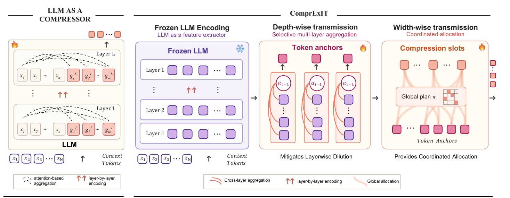

<div align="center">

# ComprExIT

### Fix the Structural Bottleneck: Context Compression via Explicit Information Transmission

**NeurIPS 2026**

Jiangnan Ye<sup>1</sup>, Hanqi Yan<sup>1,\*</sup>, Zhenyi Shen<sup>1</sup>, Heng Chang<sup>2</sup>, Ye Mao<sup>3</sup>, Yulan He<sup>1,4,\*</sup>

<sup>1</sup>King's College London &nbsp;&nbsp; <sup>2</sup>Unity China &nbsp;&nbsp; <sup>3</sup>Imperial College London &nbsp;&nbsp; <sup>4</sup>The Alan Turing Institute
<br><sup>\*</sup>Corresponding authors

[](https://neurips.cc/Conferences/2026)
[](https://arxiv.org/abs/2602.03784)
[](https://huggingface.co/collections/Jiang-nan/comprexit-6a340cd07b4f45c96fc6da65)
[](https://huggingface.co/datasets/Jiang-nan/comprexit-mrqa)
[](LICENSE)

[**News**](#-news) · [**Overview**](#-overview) · [**Highlights**](#-highlights) · [**Quick start**](#quick-start-step-by-step-reproduction) · [**Checkpoints**](#released-checkpoints) · [**Citation**](#citation)

</div>

<p align="center">
  
</p>
<p align="center"><sub><b>Left:</b> existing LLM-as-a-compressor methods encode gist tokens layer by layer through the LLM's own self-attention.
<b>Right:</b> ComprExIT reads the hidden states of a <i>frozen</i> LLM, selectively aggregates them across layers into token anchors (depth-wise),
then transmits the anchors to compression slots through a globally coordinated plan (width-wise).</sub></p>

## 📰 News

- **[2026-09]** 🎉 ComprExIT has been accepted to **NeurIPS 2026**!
- **[2026-06]** 🚀 Code, released checkpoints and preprocessed datasets are public — see the [🤗 collection](https://huggingface.co/collections/Jiang-nan/comprexit-6a340cd07b4f45c96fc6da65).
- **[2026-02]** 📄 Paper released on [arXiv](https://arxiv.org/abs/2602.03784).

## 🔍 Overview

**ComprExIT** (Context **Compr**ession via **Ex**plicit **I**nformation **T**ransmission) is a
lightweight framework for *soft* context compression: it condenses a long context into a small
set of continuous compression tokens that the LLM reads in place of the original text.

Most soft compressors follow the **LLM-as-a-compressor** paradigm — learnable gist tokens are
appended to the context and the LLM is tuned to pack the context into them through its own
self-attention. Tracing how information flows inside such a compressor, we find two structural
bottlenecks:

- **Width: lack of allocation.** Each gist token gathers information independently, without
  coordinating with the others, so several of them collapse onto the same salient regions while
  other parts of the context stay under-covered.
- **Depth: information dilution.** Information propagates layer by layer, so fine-grained
  evidence captured in earlier layers becomes entangled with later, more abstract
  representations and is hard to recover from the final gist-token states.

ComprExIT removes both by treating the **frozen LLM as a feature extractor** and performing
explicit information transmission over its hidden states:

- **Depth-wise transmission** — a token-conditioned gate aggregates each token's hidden states
  from all layers into a *token anchor*, so features from intermediate layers stay directly
  accessible.
- **Width-wise transmission** — an optimal-transport plan (solved with Sinkhorn iterations)
  globally coordinates how the token anchors are allocated to the compression slots.

## 🏆 Highlights

- 📈 **Stronger compression.** At ×4 compression on MRQA, ComprExIT beats the strongest
  soft-compression baseline in average F1 by **+18.5%** (Llama-3.2-1B) and **+10.6%** (3B) on six
  in-domain datasets, and by **+31.0%** / **+14.3%** on six out-of-domain datasets. In-domain, it
  lands within 0.5 F1 of the *uncompressed* prompt-tuning baseline.
- 🪶 **Lightweight.** The LLM stays frozen; ComprExIT adds only **~1%** trainable parameters.
- ⚡ **Fast.** The compression stage is **more than 2× faster** than ICAE (0.18 s vs. 0.43 s at
  512 tokens; 0.84 s vs. 1.93 s at 2,048 tokens).
- 🧭 **Beyond QA.** It also beats the uncompressed baseline on XSum summarization and FEVER
  fact-checking, and stays competitive on SST-2 in-context learning (see the paper's appendix).

<details>
<summary><b>Average EM / F1 on MRQA (×4 compression, 512-token context) — click to expand</b></summary>

<br>

| Method | 1B · in-domain | 1B · out-of-domain | 3B · in-domain | 3B · out-of-domain |
|---|:---:|:---:|:---:|:---:|
| *Prompt tuning (uncompressed reference)* | *55.72 / 66.72* | *48.78 / 59.40* | *62.28 / 73.35* | *57.24 / 67.68* |
| ICAE | 44.16 / 56.16 | 29.89 / 38.94 | 53.23 / 65.92 | 41.54 / 51.93 |
| 500x | 10.20 / 17.48 | 9.47 / 17.36 | 51.86 / 64.46 | 35.56 / 46.53 |
| Activation Beacon | 14.78 / 25.11 | 18.57 / 27.75 | 29.75 / 39.64 | 33.21 / 42.77 |
| **ComprExIT (ours)** | **52.34 / 66.55** | **38.38 / 51.00** | **59.02 / 72.88** | **47.19 / 59.34** |

Each cell is the average over six datasets. In-domain: SQuAD, NewsQA, TriviaQA, SearchQA,
HotpotQA, NaturalQuestions. Out-of-domain (unseen during training): BioASQ, DROP, DuoRC, RACE,
RelationExtraction, TextbookQA. Per-dataset numbers are in the paper. You can reproduce the
ComprExIT and ICAE rows from the released weights with [Track A](#track-a-evaluate-a-released-checkpoint).

</details>

---

## ✨ Reproduce it in a few commands

We worked hard to make ComprExIT **painless to reproduce** — no scavenger hunts for weights or
data, no half-documented glue scripts. If you can copy-paste, you can reproduce the paper. 🎯

- 🤗 **Weights & data live on HuggingFace.** Every released checkpoint and the preprocessed
  datasets are public — so you never have to retrain or rebuild anything just to *evaluate*.
- 🧪 **Evaluation, end-to-end.** Three little steps — **download a checkpoint → download the
  datasets → run eval** — each a ready-to-run command. See [Track A](#track-a-evaluate-a-released-checkpoint).
- 🏋️ **Training, fully scripted.** Both phases (NTP → SFT) are one-line wrappers, pre-configured
  for the paper's setup — just pass your base model / checkpoint. See [Track B](#track-b-train-from-scratch).
- 🧩 **Baselines, batteries included.** ICAE (`--model_structure icae`), 500x (`500x`), and
  Activation Beacon all run through the same machinery, so apples-to-apples comparison is one
  flag away.
- 🧬 **Bonus — SAC.** We also threw in an implementation of **SAC** (`--model_structure sac`) for
  easy side-by-side comparison. Fair warning: it's only been validated on the **1B** setting,
  isn't fully tested, and isn't part of the paper — treat it as experimental. 🚧
- 🔭 **More on the way.** We plan to keep adding implementations of other compression methods —
  contributions and requests welcome! 💛

👉 **New here? Jump straight to the [step-by-step guide](#quick-start-step-by-step-reproduction).**

---

## 🗓️ Milestones

Where we are, and where we're headed — we'd love your help ticking more of these off! 🎉

- [x] 🚀 Release **ComprExIT** — method + two-phase training (NTP → SFT) & evaluation code
- [x] 🧩 Add the **ICAE** baseline (`--model_structure icae`)
- [x] 🧩 Add the **500x** baseline (`--model_structure 500x`)
- [x] 🧩 Add the **Activation Beacon** baseline
- [x] 🤗 Upload **datasets** to HuggingFace
- [x] 🤗 Upload **checkpoints / weights** to HuggingFace
- [x] 🧬 Add the **SAC** implementation (`--model_structure sac`; experimental, 1B-only)
- [ ] 🔭 Add more compression-method implementations
- [ ] 💬 *Your idea here* — open an issue or PR!

---

## Quick start: step-by-step reproduction

A guided walkthrough from a fresh clone to reproduced numbers. **Do [Step 0](#step-0-one-time-setup)
once**, then pick the track that matches your goal:

| Your goal | Follow | Roughly |
|---|---|---|
| Reproduce our reported numbers from released weights | **[Track A — Evaluate](#track-a-evaluate-a-released-checkpoint)** | minutes, no training |
| Train ComprExIT yourself, end to end | **[Track B — Train](#track-b-train-from-scratch)** | a full NTP → SFT run |

At a glance — one shared setup, then two independent tracks:

```
                           ┌────────────────────────────────────────────┐
                           │          Step 0 · one-time setup           │
                           │      uv sync  ·  cp .env.example .env      │
                           └────────────────────────────────────────────┘
                                                  │
                       ┌──────────────────────────┴──────────────────────────┐
                       │                                                     │
   ┌──────────────────────────────────────┐              ┌──────────────────────────────────────┐
   │  Track A · Evaluate released weights │              │  Track B · Train from scratch        │
   │  (minutes, no training)              │              │  (a full NTP -> SFT run)             │
   ├──────────────────────────────────────┤              ├──────────────────────────────────────┤
   │  A.1  download a checkpoint          │              │  B.1  get base + datasets            │
   │  A.2  download MRQA data             │              │  B.2  NTP pretraining                │
   │  A.3  run evaluation                 │              │  B.3  SFT on MRQA                    │
   │                                      │              │  B.4  evaluate                       │
   └──────────────────────────────────────┘              └──────────────────────────────────────┘
```

> Track B ends by reusing **Track A.3** to score your freshly trained checkpoint.

### Step 0: one-time setup

**0.1 — Install the environment.** We use [`uv`](https://docs.astral.sh/uv/) for fast,
reproducible installs:

```bash
curl -LsSf https://astral.sh/uv/install.sh | sh   # skip if you already have uv
uv sync                                            # create venv + install pinned deps (Python 3.9)
# uv sync --extra viz                              # optional: plotting deps to redraw paper figures
```

The scripts under `scripts/` already wrap their launch in `uv run`, so you can run them
directly. For ad-hoc commands, prefix with `uv run …` (e.g. `uv run python train.py --help`) or
activate the venv once with `source .venv/bin/activate`.

**0.2 — Set your data/output paths.** These are stable, so they live in the environment — copy
the template and edit:

```bash
cp .env.example .env
#   DATA_DIR   → where datasets will be stored
#   OUTPUT_DIR → where training writes checkpoints/logs (default ./training_outputs)
```

> 💡 The **model/checkpoint you operate on is *not* an env var** — you pass it as a script
> argument (a base model to train, or a checkpoint to evaluate). Details in the
> [Configuration reference](#configuration-reference).

The code runs on CUDA GPUs (DDP via `nccl`) and uses [`liger_kernel`](https://github.com/linkedin/Liger-Kernel)
for efficient kernels. If the default `torch` wheel doesn't match your hardware, see
[Notes & troubleshooting](#notes-and-troubleshooting).

---

### Track A: evaluate a released checkpoint

No training required — download our weights and score them on MRQA.

**A.1 — Download a checkpoint.** Browse the full list in [Released checkpoints](#released-checkpoints);
here's the 1B ComprExIT SFT model:

```bash
uv run python scripts/downloading/download_model.py \
    --repo_id Jiang-nan/comprexit-1b-4x-sft --target_dir ./checkpoints/comprexit-1b-4x-sft
```

**A.2 — Download the MRQA evaluation data** into `$DATA_DIR`. Fetch the files verbatim with
`hf download` (the loader expects a tree of `<subset>/<split>_<name>.jsonl.gz` — don't use
`load_dataset`):

```bash
hf download Jiang-nan/comprexit-mrqa     --repo-type dataset --local-dir "$DATA_DIR/mrqa"
hf download Jiang-nan/comprexit-mrqa-ood --repo-type dataset --local-dir "$DATA_DIR/mrqa_ood"
```

**A.3 — Run evaluation** (in-domain → the paper's main results table; out-of-domain → the
out-of-domain MRQA table in the appendix):

```bash
# In-domain
uv run python -m src.evaluation.eval_datasets \
    --model_folders ./checkpoints/comprexit-1b-4x-sft --partition mrqa     --compress_ratio 4

# Out-of-domain
uv run python -m src.evaluation.eval_datasets \
    --model_folders ./checkpoints/comprexit-1b-4x-sft --partition mrqa_ood --compress_ratio 4
```

Exact-Match / F1 are computed by `src/evaluation/metrics.py`. 🎉 That's the whole eval pipeline.

---

### Track B: train from scratch

Reproduce ComprExIT's two-phase recipe — **NTP pretraining → SFT on QA** — then evaluate.

**B.1 — Get the base model + datasets.**

```bash
# NTP pretraining corpus (SlimPajama-6B):
uv run python scripts/downloading/download_dataset.py \
    --repo_id DKYoon/SlimPajama-6B --target_dir "$DATA_DIR/slim_pajama_6b"

# SFT + evaluation data (MRQA) — same as Track A.2:
hf download Jiang-nan/comprexit-mrqa     --repo-type dataset --local-dir "$DATA_DIR/mrqa"
hf download Jiang-nan/comprexit-mrqa-ood --repo-type dataset --local-dir "$DATA_DIR/mrqa_ood"

# Base model = any HF Llama id or local path, e.g. meta-llama/Llama-3.2-1B
```

**B.2 — Phase 1: NTP pretraining.** First argument = the base model:

```bash
bash scripts/llama-3.2/ntp/512_ot_2mlp_1b.sh meta-llama/Llama-3.2-1B
# → writes to $OUTPUT_DIR/512-128-1b-ot-learnable-a-ntp1.0-gpu/checkpoint-XXXX
```

**B.3 — Phase 2: SFT on MRQA.** First argument = the NTP checkpoint produced in B.2:

```bash
bash scripts/llama-3.2/sft/mrqa_ot_2mlp_1b.sh \
    "$OUTPUT_DIR/512-128-1b-ot-learnable-a-ntp1.0-gpu/checkpoint-763"
```

**B.4 — Evaluate your checkpoint.** Run [Track A.3](#track-a-evaluate-a-released-checkpoint),
pointing `--model_folders` at your SFT output directory.

> **The per-experiment scripts are examples.** `512_icae.sh`, `512_500x.sh`, `beacon.sh`, the
> prompt-tuning scripts, and the `ntp_3b/` + `sft_3b/` variants all follow the same pattern —
> they differ only in a few hyperparameters (model size, batch size / grad-accum to fit GPU
> memory, method-specific knobs). Each `.sh` is a thin wrapper that sets those and calls
> `train.py` via `torchrun`. Copy the closest one and tweak; run `uv run python train.py --help`
> for the full argument list.

### Reproducing the baselines

Every baseline rides the **same two tracks above** — just pick the matching script (training) or
flag (evaluation):

| Baseline | Training scripts (NTP / SFT) | Selector |
|---|---|---|
| **ICAE** | `…/ntp/512_icae.sh` · `…/sft/mrqa_icae_1b.sh` | `--model_structure icae` |
| **500x** | `…/ntp/512_500x.sh` · `…/sft/mrqa_500x_1b.sh` | `--model_structure 500x` |
| **SAC** | (use `train.py` with the flag) | `--model_structure sac` — experimental, 1B-only |
| **Activation Beacon** | `…/ntp/beacon.sh` · `…/sft/mrqa_beacon.sh` | **separate env** → [its README](src/baselines/activation_beacon/README.md) |
| **Prompt-tuning / Zero-shot** | `…/sft/mrqa_prompt_tuning_base.sh` | eval modes in `eval_datasets.py` |

---

## Released checkpoints

All released checkpoints are gathered in the
**🤗 [ComprExIT collection](https://huggingface.co/collections/Jiang-nan/comprexit-6a340cd07b4f45c96fc6da65)**.
Download any of them with the command in [Track A.1](#track-a-evaluate-a-released-checkpoint).

We release ComprExIT and ICAE-baseline checkpoints at **×4 compression** for both training
phases (NTP pretraining and MRQA SFT), spanning Llama-3.2 **1B**/**3B** and Llama-3.1 **8B**,
plus **1B long-context (8192-token)** variants. The `{ntp,sft}` suffix selects the phase.

| Variant | ComprExIT | ICAE baseline |
|---|---|---|
| 1B · 512-ctx · 4× | `Jiang-nan/comprexit-1b-4x-{ntp,sft}` | `Jiang-nan/icae-1b-4x-{ntp,sft}` |
| 3B · 512-ctx · 4× | `Jiang-nan/comprexit-3b-4x-{ntp,sft}` | `Jiang-nan/icae-3b-4x-{ntp,sft}` |
| 8B · 512-ctx · 4× | `Jiang-nan/comprexit-8b-4x-{ntp,sft}` | `Jiang-nan/icae-8b-4x-{ntp,sft}` |
| 1B · 8192-ctx · 4× | `Jiang-nan/comprexit-1b-4x-long8192-{ntp,sft}` | `Jiang-nan/icae-1b-4x-long8192-{ntp,sft}` |

> **Weights license.** The released checkpoints are derived from Meta's Llama models and are
> therefore subject to the [Llama 3.2 Community License](https://github.com/meta-llama/llama-models/blob/main/models/llama3_2/LICENSE).
> The **code** in this repository is licensed under Apache-2.0 (see [`LICENSE`](LICENSE)).

---

## Datasets

We use **SlimPajama-DC** (1B tokens) for NTP pretraining and **MRQA** for SFT and evaluation:

- **In-domain (6):** SQuAD, NewsQA, TriviaQA, SearchQA, HotpotQA, NaturalQuestions
- **Out-of-domain (6):** BioASQ, DROP, DuoRC, RACE, RelationExtraction, TextbookQA

The preprocessed MRQA splits are hosted as HuggingFace datasets (`Jiang-nan/comprexit-mrqa` and
`…-mrqa-ood`); the NTP corpus comes from `DKYoon/SlimPajama-6B`. Download commands are in
[Step B.1](#track-b-train-from-scratch) and [Track A.2](#track-a-evaluate-a-released-checkpoint).

---

## Method overview

| Paper concept | Where in the code |
|---|---|
| ComprExIT (depth-wise + width-wise transmission) | `--model_structure hier --pooling_method ot-dy-src` |
| Depth-wise gating over frozen layers (token anchors) | `src/model/pooling.py`, `--top_k_layers`, `--layerwise_pooling_*` |
| Width-wise transmission plan (Sinkhorn / OT) | `src/model/pooling.py`, `--ot_window_size`, `--ot_n_iter`, `--ot_metric_dim` |
| Two-phase training (NTP → SFT) | `train.py --mode {ntp,sft}` |

---

## Repository layout

```
train.py                         # main training entry point (NTP & SFT), launched via torchrun
src/
  model/        model.py         # all model classes + get_model_factory()
                pooling.py       # Pooling subclasses (ot-dy-src = ComprExIT)
                inference.py     # compress-and-generate helpers
  data_processing/               # NTP + SFT preprocessing, data loading
  training/     trainer.py       # CompressInTrainer (DDP loss averaging, SFT eval)
  evaluation/   eval_datasets.py # QA evaluator (in-domain + OOD partitions), metrics
  baselines/activation_beacon/   # Activation Beacon baseline (separate env)
scripts/
  downloading/                   # dataset / model download helpers
  llama-3.2/
    ntp/ ntp_3b/                 # NTP pretraining (1B / 3B) for each method
    sft/ sft_3b/                 # supervised fine-tuning (1B / 3B) for each method
configs/                         # config templates
```

---

## Configuration reference

Two kinds of paths, handled differently:

- **Stable locations → environment variables** (set once in `.env`, see [Step 0.2](#step-0-one-time-setup)):

  | Variable | Meaning |
  |---|---|
  | `DATA_DIR`   | Root directory holding the datasets |
  | `OUTPUT_DIR` | Where runs write checkpoints/logs (default `./training_outputs`) |
  | `MASTER_ADDR` | *(multi-node only)* `torchrun` rendezvous host; unset ⇒ current hostname |

- **The model / checkpoint you operate on → a script argument** (it changes every run):

  | What | How it's passed |
  |---|---|
  | Base model (NTP & prompt-tuning scripts) | **first argument** to the script — local path or HF repo id |
  | NTP checkpoint to fine-tune (SFT scripts) | **first argument** to the SFT script |
  | Checkpoint to evaluate | `--model_folders <path>` on `eval_datasets.py` |

  Each script aborts with a usage message if the required argument is missing.

---

## Notes and troubleshooting

> **torch builds.** The default PyPI `torch==2.8.0` wheel on Linux x86_64 bundles a CUDA 12.8
> build, which works on most NVIDIA GPUs. For CPU-only or a different CUDA version, uncomment the
> matching `[[tool.uv.index]]` / `[tool.uv.sources]` block in `pyproject.toml` and re-run
> `uv lock && uv sync` (or see [pytorch.org](https://pytorch.org)).

> **Attention backend (flash-attn is optional).** `uv sync` does **not** install `flash_attn` — it
> is only needed by the Activation Beacon baseline. The training scripts request
> `flash_attention_2` for speed, but when it isn't importable the code automatically falls back to
> the `eager` backend (you'll see a one-line warning), so the default environment runs out of the
> box. For higher throughput, install flash-attn separately (e.g. `uv pip install flash-attn
> --no-build-isolation`) or pass `--attn_implementation eager` explicitly to silence the warning.
> Note the ComprExIT compressor does not support the `sdpa` backend — use `flash_attention_2` or
> `eager`.

> **Weights & Biases is optional.** Training logs to W&B if credentials are present (`wandb login`
> or `WANDB_API_KEY`). With no credentials the run auto-disables reporting (one-line warning)
> instead of failing; pass `--report_to none` to opt out explicitly.

> **Want a plain `requirements.txt`?** `pyproject.toml` + `uv.lock` are the source of truth. For
> a pip-style requirements file (e.g. a different toolchain), run
> `uv export --format requirements-txt > requirements.txt`.

> **Activation Beacon baseline.** The `uv` environment covers ComprExIT and the ICAE / 500x /
> prompt-tuning baselines. The **Activation Beacon** baseline is a separate, self-contained
> codebase with its own heavier dependencies (`deepspeed`, `flash-attn`, `vllm`, `fuzzywuzzy`,
> `jieba`, …) that are **not** installed by `uv sync`. Anything Beacon-related — the `beacon.sh`
> / `mrqa_beacon*.sh` scripts and evaluating a Beacon checkpoint (loaded lazily by
> `src/evaluation/utils_eval.py`) — needs that environment. See
> [`src/baselines/activation_beacon/README.md`](src/baselines/activation_beacon/README.md) for
> its setup and usage.

---

## Citation

If you find ComprExIT useful in your research, please cite our NeurIPS 2026 paper:

```bibtex
@inproceedings{ye2026fixstructuralbottleneckcontext,
  title     = {Fix the Structural Bottleneck: Context Compression via Explicit Information Transmission},
  author    = {Ye, Jiangnan and Yan, Hanqi and Shen, Zhenyi and Chang, Heng and Mao, Ye and He, Yulan},
  booktitle = {Advances in Neural Information Processing Systems (NeurIPS)},
  year      = {2026},
  url       = {https://arxiv.org/abs/2602.03784}
}
```

## License

Code: Apache-2.0 (see [`LICENSE`](LICENSE)). Released model weights are additionally subject
to the Llama 3.2 Community License (see [Released checkpoints](#released-checkpoints)).
